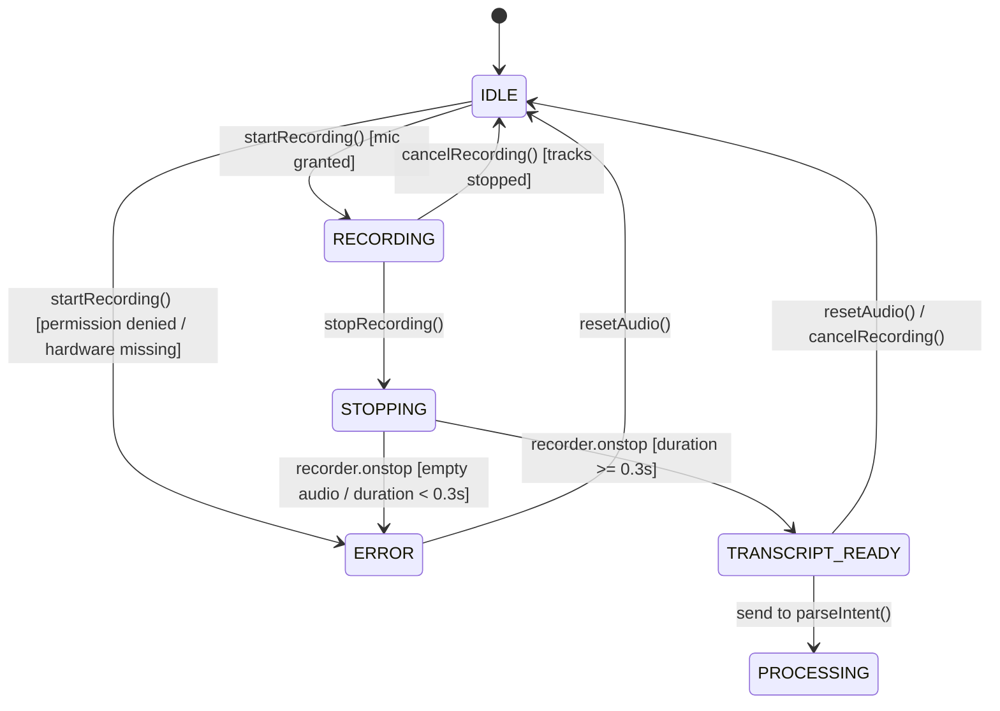

# BolKhata AI — Phase 4: Push-To-Talk Merchant Frontend & HITL Confirmation UI

**Implementation Report Date:** November 22, 2026  
**Audience:** Senior Frontend Engineer, React Architect, UX Designer, Accessibility Engineer, Full-Stack Integration Engineer  
**Status:** **COMPLETED / PRODUCTION READY**  
**Frontend Tests:** **20 passed (100% pass rate in 3.27s)**  
**Backend Regression Tests:** **112 passed, 6 deselected (100% pass rate in 2.47s)**  
**Frontend Production Build:** **Clean (`tsc -b && vite build` succeeded in 5.67s)**

---

## 1. Executive Summary & Phase 4 Scope

Phase 4 delivers the complete, responsive, merchant-friendly frontend interface for **BolKhata AI** — *"Your Kirana Store. Your Voice. Your Digital Khata."*

The frontend is built specifically for Indian kirana storekeepers operating in fast-paced, noisy retail store environments. It prioritizes:
1. **Push-To-Talk Voice Interaction**: An accessible, large, tactile microphone interface with live visual states (`IDLE`, `RECORDING`, `STOPPING`, `PROCESSING`, `TRANSCRIPT_READY`, `ERROR`), audio duration display, and captured audio playback preview.
2. **Authoritative Human-In-The-Loop (HITL) Confirmation**: Real, server-staged transaction proposals fetched from the FastAPI backend are reviewed by the shopkeeper. No financial balance mutation occurs until the merchant explicitly clicks **Confirm Transaction**.
3. **Double-Click & Idempotency Safeguards**: Stable client-side idempotency keys prevent duplicate transaction commits across retries or repeated taps.
4. **Read-Only & Unclear Intent Handling**: `QUERY_BALANCE` and `LIST_DUES` render read-only informational cards without financial commit buttons; `UNKNOWN` triggers a clarification prompt.
5. **Customer Disambiguation & Management**: Transparently surfaces multiple candidate matches when customer names collide, requiring explicit merchant selection without silent customer merging.
6. **Trilingual Localization**: Native support for **Kannada (ಕನ್ನಡ)**, **Hindi (हिन्दी)**, and **Indian English**.

---

## 2. Frontend Architecture & Design System

### Visual Palette
Designed to look like a trusted, tactile Indian fintech product rather than a generic tech admin dashboard:
- **Background:** Warm ivory / cream (`#FAF7F2`)
- **Cards:** Pure white with subtle borders (`border-stone-200/90`) and rounded corners (`rounded-2xl`)
- **Text:** Deep charcoal text (`text-stone-900` / `#1C1917`) with secondary captions in `text-stone-500`
- **Credit (Udhaar):** Warm amber/terracotta (`text-amber-800`, `bg-amber-100`, `border-amber-300`)
- **Payment (Jama):** Muted emerald green (`text-emerald-700`, `bg-emerald-100`, `border-emerald-300`)
- **Touch Targets:** All primary buttons are at least `48px` tall with visible focus rings.

### Component Hierarchy
```
src/
├── api/
│   └── client.ts                   # Centralized typed BolKhata API client
├── context/
│   └── StoreContext.tsx            # Global state (language, store tenancy, summaries, toasts)
├── hooks/
│   └── useAudioRecorder.ts         # MediaRecorder browser microphone hook
├── i18n/
│   └── translations.ts             # Multilingual dictionary (kn, hi, en)
├── types/
│   └── api.ts                      # Strongly typed interfaces matching backend Pydantic models
├── components/
│   ├── Header.tsx                  # Store brand, health check, language switcher, store UUID
│   ├── Navigation.tsx              # Desktop sub-header + Mobile bottom navigation bar
│   ├── SummaryCards.tsx            # Aggregate store metrics (Outstanding, Jama, Customers)
│   ├── Dashboard.tsx               # Primary merchant home screen
│   ├── VoiceAssistant.tsx          # Push-to-Talk recording, quick Indic samples, manual input
│   ├── TranscriptPreview.tsx       # Recognized speech transcript, language, and confidence
│   ├── IntentProposalCard.tsx      # HITL confirmation card (Confirm, Reject, Replay notice)
│   ├── CustomerDisambiguation.tsx  # Multi-customer collision disambiguation dialog
│   ├── CustomerList.tsx            # Searchable customer list + Add Customer modal
│   ├── CustomerDetail.tsx          # Customer profile + current balance breakdown
│   ├── LedgerHistory.tsx           # Chronological immutable transaction entries
│   └── Toast.tsx                   # Non-intrusive alert toasts
├── test/
│   ├── setup.ts                    # Vitest / testing-library setup
│   ├── api_client.test.ts          # API client unit tests
│   ├── audio_recorder.test.tsx     # Audio recording state machine tests
│   ├── dashboard.test.tsx          # Dashboard, summary cards, and language switching tests
│   └── hitl_proposal.test.tsx      # HITL confirmation, double-click, and safety tests
├── App.tsx                         # Main layout router
├── index.css                       # Tailwind directives and warm ivory theme
└── main.tsx                        # React DOM root mounting
```

---

## 3. API Integration Mapping

The frontend communicates with the FastAPI backend through a centralized, typed client (`src/api/client.ts`). In development, Vite proxies `/api` and `/health` requests directly to `http://127.0.0.1:8000`.

| Frontend Function | Backend HTTP Method & Endpoint | Payload / Parameters | Response Schema | Purpose |
|---|---|---|---|---|
| `getHealth()` | `GET /health` | None | `BackendHealthResponse` | Verifies backend connectivity & active version |
| `getStoreSummary()` | `GET /api/v1/ledger/summary` | Header: `X-Store-Id` | `StoreSummaryResponse` | Aggregates store credit, payment, and customer count |
| `listCustomers(q, limit, offset)` | `GET /api/v1/customers` | Query: `?q=&limit=&offset=` | `CustomerListResponse` | Searches/lists store customer records |
| `getCustomer(id)` | `GET /api/v1/customers/{id}` | Path: `id` | `Customer` | Retrieves single customer metadata |
| `createCustomer(data)` | `POST /api/v1/customers` | `{ customer_name, phone_number }` | `Customer` | Registers a new customer under the current store |
| `getCustomerBalance(id)` | `GET /api/v1/ledger/customers/{id}/balance` | Path: `id` | `CustomerBalanceResponse` | Calculates deterministic outstanding balance |
| `getCustomerEntries(id, limit, offset)` | `GET /api/v1/ledger/customers/{id}/entries` | Path: `id`, Query: `?limit=&offset=` | `CustomerEntriesResponse` | Paginated chronological ledger entries |
| `parseIntent(transcript, language)` | `POST /api/v1/intent/parse` | `{ transcript, language }` | `ParseIntentResponse` | Stateless Groq LLM intent parser (0 DB mutations) |
| `stageProposal(data)` | `POST /api/v1/ledger/proposals` | `StageProposalRequest` | `PendingProposalResponse` | Stages proposal on server with 15-min TTL |
| `commitProposal(data)` | `POST /api/v1/ledger/commit` | `CommitProposalRequest` | `LedgerCommitResponse` | Commits proposal to immutable ledger |
| `rejectProposal(id, reason)` | `POST /api/v1/ledger/proposals/{id}/reject` | Path: `id`, Query: `?reason=` | `PendingProposalResponse` | Explicitly marks proposal as REJECTED |

---

## 4. Push-To-Talk Microphone Implementation

Implemented in `src/hooks/useAudioRecorder.ts` using the browser's native `MediaRecorder` and `navigator.mediaDevices.getUserMedia` APIs.

### Recording Lifecycle States


### Safety & Resource Management
1. **Track Cleanup:** Whenever recording stops, is cancelled, or the component unmounts, all active `MediaStreamTrack` instances are stopped immediately (`track.stop()`) to release the hardware microphone lock.
2. **Object URL Lifecycle:** Audio preview URLs generated via `URL.createObjectURL(blob)` are revoked on reset, cancel, or unmount (`URL.revokeObjectURL(url)`) to prevent browser memory leaks.
3. **Empty Recording Safeguard:** Audio recordings shorter than 0.3 seconds or containing zero chunks are rejected with an explicit error: *"Empty or too short audio recording. Please speak clearly."*
4. **Browser Compatibility:** Verifies `window.MediaRecorder` and `navigator.mediaDevices.getUserMedia` availability before attempting recording.

---

## 5. Human-In-The-Loop (HITL) Proposal Confirmation Workflow

The HITL confirmation card (`src/components/IntentProposalCard.tsx`) represents the core financial safety gate of BolKhata AI:

1. **Authoritative Server Values:** The client displays the exact proposal staged by the server (`stagedProposal.amount`, `stagedProposal.customer_name`, `stagedProposal.intent`). Client-side modification is impossible.
2. **Double-Click Prevention:** While a commit request is pending, `isCommitting` is set to `true`, disabling the Confirm button and rendering an inline spinner.
3. **Stable Idempotency Key:** The confirmation request passes a stable key (`frontend_commit_<proposal_id>_<timestamp>`). Retrying a network request reuses the exact same idempotency key rather than creating a new one.
4. **Replay Detection (`is_duplicate: true`):** If the server reports that the transaction was already committed (e.g. from network retry or concurrent submission), the UI displays a blue replay notice informing the merchant that the transaction was safely recognized and no duplicate credit was applied.
5. **Read-Only Intent Protection:** When the parsed intent is `QUERY_BALANCE` or `LIST_DUES`, the UI displays an informational card. The Confirm button is completely absent from the DOM.
6. **Unclear Intent Protection:** When the parsed intent is `UNKNOWN`, the UI renders a clarification prompt displaying `proposal.clarification_question` with reasoning details.

---

## 6. Customer Disambiguation & Management

In Indian retail kirana stores, shopkeepers frequently service customers with identical or phonetically similar names (e.g. two customers named "Ramesh Kumar").

### Disambiguation Flow
1. If the merchant initiates a transaction for a name that matches multiple active store records, `LedgerService` returns an HTTP 409 `CustomerAmbiguityError`.
2. The frontend catches this error and renders `<CustomerDisambiguation />`.
3. The merchant is presented with candidate cards showing:
   - Full customer name
   - Registered phone number
   - Account creation date
   - Customer ID snippet
4. The merchant must explicitly click **Select This Customer** for the intended account, or click **Create as New Customer** with a distinct phone number.
5. The system never merges accounts automatically.

---

## 7. Multilingual Internationalization (i18n)

UI strings are centralized in `src/i18n/translations.ts` across three languages:
- **Kannada (`kn`):** Default language for regional kirana storekeepers in Karnataka.
- **Hindi (`hi`):** First-class support for Hindi-speaking retail merchants.
- **English (`en`):** Standard Indian English fintech terminology.

### Localization Rules
- Financial amounts (`₹340.00`), customer UUIDs, and canonical intents (`ADD_CREDIT`, `LOG_PAYMENT`) are strictly preserved as authoritative machine-readable values.
- Switching language is dynamic and non-destructive to in-progress proposals.
- Preference is persisted in browser `localStorage`.

---

## 8. Current Limitations & Phase 5 Integration Contract

### What Works End-to-End in Phase 4
- Complete merchant dashboard displaying live store totals from the deterministic ledger.
- Full customer directory: search, registration, balance calculation, and chronological ledger history.
- Push-to-Talk browser microphone recording with live audio duration and playback preview.
- Quick Indic utterance shortcuts in Kannada, Hindi, and English.
- Authoritative Groq LLM intent parsing (`POST /api/v1/intent/parse`).
- Server-side proposal staging (`POST /api/v1/ledger/proposals`).
- HITL confirmation and rejection (`POST /api/v1/ledger/commit` and `/reject`).
- Idempotency replay detection (`is_duplicate: true`).
- Customer disambiguation on naming collisions.

### Phase 5 Integration Contract (Gnani Prisma v3.0 Real-Time Voice Bridge)
> [!NOTE]
> In Phase 4, the frontend records audio via the standard browser `MediaRecorder` API (`audio/webm` or `audio/wav`).  
> The backend's Gnani Prisma v3.0 connector (`app/voice/stt.py`) requires a raw `Signed 16-bit PCM Little-Endian @ 16000 Hz Mono` stream over WebSocket (`wss://api.vachana.ai/stt/v3/stream`).
>
> **Phase 5 Contract:**
> 1. A WebSocket proxy endpoint (`/api/v1/voice/stream`) will be introduced on the FastAPI backend.
> 2. The browser frontend will utilize an `AudioWorkletNode` or WebAssembly PCM resampler to stream 16 kHz 16-bit mono chunks directly to the backend.
> 3. The backend will forward chunks to Gnani Prisma v3.0 in real time, pipe the resulting transcript to `GroqIntentParser`, and stream back proposals and audio responses via Gnani Timbre v3.0 (TTS).

---

## 9. Test Execution Results

### 1. Frontend Test Suite (Vitest + Testing Library)
```bash
cd frontend
npm test
```

```text
 RUN  v4.1.12 C:/Users/VISHAL/OneDrive/Desktop/BolKhata AI/frontend

 ✓ src/test/api_client.test.ts (4 tests) 11ms
 ✓ src/test/audio_recorder.test.tsx (4 tests) 26ms
 ✓ src/test/hitl_proposal.test.tsx (7 tests) 147ms
 ✓ src/test/dashboard.test.tsx (5 tests) 194ms

 Test Files  4 passed (4)
      Tests  20 passed (20)
   Duration  3.27s
```

### 2. Frontend Production Build Check
```bash
cd frontend
npm run build
```

```text
> bolkhata-frontend@0.1.0 build
> tsc -b && vite build

vite v5.4.21 building for production...
transforming...
✓ 1592 modules transformed.
rendering chunks...
computing gzip size...
dist/index.html                   0.63 kB │ gzip:  0.42 kB
dist/assets/index-BBnQSxgJ.css   29.74 kB │ gzip:  5.73 kB
dist/assets/index-CqgwXVsC.js   223.10 kB │ gzip: 66.54 kB
✓ built in 5.67s
```

### 3. Backend Regression Test Suite (Pytest)
```bash
backend\.venv\Scripts\python -m pytest -m "not integration"
```

```text
============================= test session starts =============================
platform win32 -- Python 3.12.10, pytest-9.2.0, pluggy-1.7.0
rootdir: C:\Users\VISHAL\OneDrive\Desktop\BolKhata AI
configfile: pytest.ini
testpaths: backend/tests, tests
plugins: anyio-4.16.0, asyncio-1.5.0
collected 118 items / 6 deselected / 112 selected

backend\tests\test_audit.py ...                                          [  2%]
backend\tests\test_gnani_stt.py .............                            [ 14%]
backend\tests\test_gnani_tts.py ..........                               [ 23%]
backend\tests\test_health.py ...                                         [ 25%]
backend\tests\test_hitl_commit.py ........                               [ 33%]
backend\tests\test_idempotency.py ....                                   [ 36%]
backend\tests\test_intent_parser.py .........................            [ 58%]
backend\tests\test_ledger_api.py .....                                   [ 63%]
backend\tests\test_ledger_service.py ..........                          [ 72%]
backend\tests\test_models.py ............                                [ 83%]
backend\tests\test_phase3_1_audit.py ...............                     [ 96%]
backend\tests\test_safety_isolation.py ..                                [ 98%]
tests\test_monorepo.py ..                                                [100%]

====================== 112 passed, 6 deselected in 2.47s ======================
```

---

## 10. Instructions to Run Locally

### 1. Start FastAPI Backend
```bash
cd backend
.venv\Scripts\activate
uvicorn app.main:app --host 127.0.0.1 --port 8000 --reload
```
*Backend will be available at `http://127.0.0.1:8000` with Swagger docs at `http://127.0.0.1:8000/docs`.*

### 2. Start Vite Frontend Dev Server
```bash
cd frontend
npm run dev
```
*Frontend will be available at `http://localhost:5173` with automatic API proxying to port 8000.*

---

## 11. Phase 4 Verdict

### **VERDICT: COMPLETE / VERIFIED**

The Phase 4 merchant frontend and Human-In-The-Loop confirmation UI have been built, styled, integrated, tested, and documented. The application strictly honors the financial integrity guarantees established in Phases 2, 3, and 3.1.
