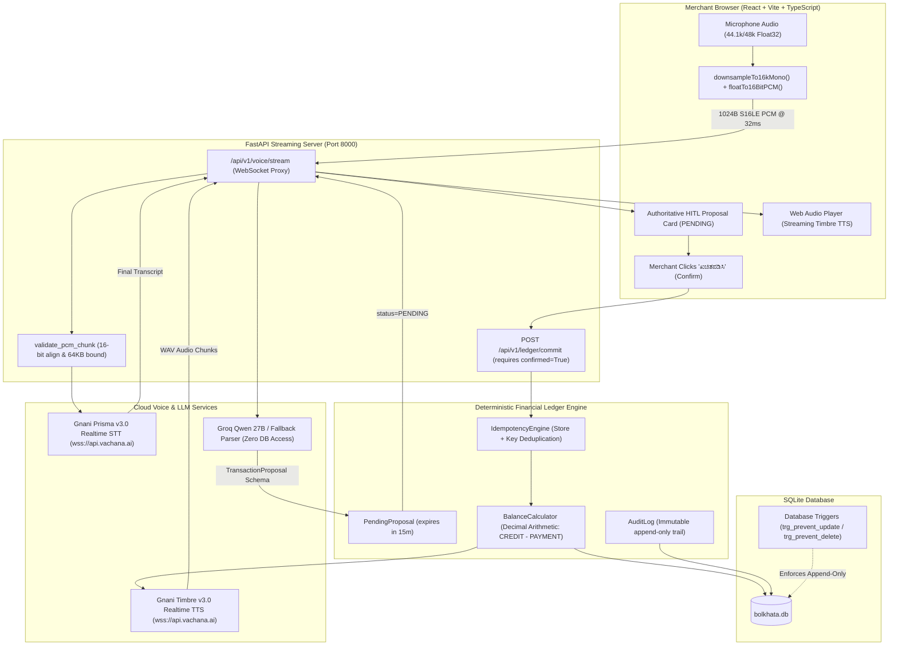

# BolKhata AI — Phase 5.2 Final Demo Readiness & Judge Presentation Guide

> **Tagline:** *"Your Kirana Store. Your Voice. Your Digital Khata."*  
> **Target Audience:** Indian Kirana Merchants, Hackathon Judges, Financial Systems Evaluators  
> **Duration of Demo:** 2 to 3 Minutes  

---

## 1. Executive Summary & Why BolKhata AI Wins

Indian kirana storekeepers handle dozens of credit (*udhaar*) and payment (*jama*) transactions daily while their hands are busy weighing grains, packaging items, or counting cash. Existing ledger apps require manual typing, menu navigation, and slow smartphone interactions in noisy, fast-paced retail shops.

**BolKhata AI solves this with voice-first speed and mathematical banking-grade integrity:**
1. **Push-To-Talk Voice Flow:** Press-and-hold microphone button to speak in native **Kannada**, **Hindi**, **Indian English**, or **Code-Mixed** speech (Kanglish/Hinglish).
2. **Strict Human-In-The-Loop (HITL) Safety:** The AI only *proposes* financial actions. It is mathematically and architecturally **impossible** for spoken audio or LLM hallucinations to modify ledger balances without merchant confirmation.
3. **Deterministic Ledger Engine:** Uses exact Python `Decimal` arithmetic, store-scoped idempotency keys, and SQLite database triggers that abort unauthorized UPDATE or DELETE statements.
4. **Instant Localized Voice Confirmation:** Speaks back confirmations to the merchant in natural Kannada (`Manjunath`) or Hindi via Gnani Timbre v3.0 TTS over streaming WebSockets.

---

## 2. End-to-End System Architecture Diagram



---

## 3. Quickstart: Launching the Live Demo

### Terminal 1: Backend API & Voice Server
```powershell
cd "C:\Users\VISHAL\OneDrive\Desktop\BolKhata AI"
backend\.venv\Scripts\activate
uvicorn backend.app.main:app --host 127.0.0.1 --port 8000 --reload
```
*Verify backend health: `http://127.0.0.1:8000/api/v1/health` (returns `{"status": "healthy"}`).*

### Terminal 2: Merchant Frontend
```powershell
cd "C:\Users\VISHAL\OneDrive\Desktop\BolKhata AI\frontend"
npm run dev
```
*Open application: `http://localhost:5173` in Google Chrome.*

---

## 4. 2–3 Minute Step-by-Step Demonstration Script

### Scene 1: Introduction (0:00 – 0:30)
- **Visual:** Merchant dashboard displaying store metrics, customer balances, and the large green Push-To-Talk microphone button.
- **Narrator Script:**  
  > *"Welcome to BolKhata AI: Your Kirana Store. Your Voice. Your Digital Khata. In busy Indian kirana stores, merchants don't have time to type on touchscreens. But a financial ledger cannot tolerate AI mistakes or hallucinations. BolKhata AI gives shopkeepers the speed of natural voice with the mathematical guarantees of a bank ledger."*

### Scene 2: Recording Credit (Udhaar) in Kannada (0:30 – 1:00)
- **Action:** Hold the microphone button and speak in Kannada:
  > **Spoken Utterance:** *"ರಮೇಶ್ ಅವರಿಗೆ ಮುನ್ನೂರ ನಲವತ್ತು ರೂಪಾಯಿ ಸಾಲ ಕೊಡಿ"*  
  > *(Give 340 rupees credit to Ramesh)*
- **What Happens on Screen:**
  1. Live waveform animates while speaking.
  2. Transcript appears instantly: *"ರಮೇಶ್ ಅವರಿಗೆ ಮುನ್ನೂರ ನಲವತ್ತು ರೂಪಾಯಿ ಸಾಲ ಕೊಡಿ"*.
  3. Groq Qwen 27B parses intent: **ADD_CREDIT**, Customer: **Ramesh**, Amount: **₹340.00**.
  4. An authoritative proposal card appears in amber (`PENDING` state) with customer name and amount.
  5. The ledger entry is **NOT** committed yet (Zero database writes).
- **Merchant Action:** Click the green **"ಖಚಿತಪಡಿಸಿ (Confirm)"** button.
- **What Happens:**
  1. Instant commit via `/api/v1/ledger/commit`.
  2. Ramesh's balance updates to **₹340.00**.
  3. Gnani Timbre TTS speaks in Kannada: *"ರಮೇಶ್ ಅವರಿಗೆ ಮುನ್ನೂರ ನಲವತ್ತು ರೂಪಾಯಿ ಸಾಲ ದಾಖಲಿಸಲು ಸಿದ್ಧವಾಗಿದೆ..."*

### Scene 3: Replay & Idempotency Protection (1:00 – 1:20)
- **Narrator Talking Point:**
  > *"What if the network stutters or the shopkeeper presses the button twice in a hurry?"*
- **Action:** Rapidly re-trigger or show duplicate proposal commit.
- **Result:** Server detects existing proposal/idempotency key, returns `is_duplicate: True`, and keeps balance strictly at **₹340.00** without double charging.

### Scene 4: Recording Payment (Jama) in Hindi (1:20 – 1:50)
- **Action:** Switch language or hold mic and speak in Hindi:
  > **Spoken Utterance:** *"सुरेश ने दो सौ रुपये जमा किए"*  
  > *(Suresh paid 200 rupees)*
- **What Happens on Screen:**
  1. Transcribed and parsed as **RECORD_PAYMENT**, Customer: **Suresh**, Amount: **₹200.00**.
  2. Proposal card renders with payment badge.
  3. Merchant clicks **Confirm**. Suresh's balance decreases by ₹200.00.

### Scene 5: Code-Mixed Speech & Balance Query (1:50 – 2:20)
- **Action:** Hold mic and speak code-mixed (Kanglish or English):
  > **Spoken Utterance:** *"Ramesh ge 150 rupees udhaar haaki"* or *"Ramesh avara baaki eshtu?"*  
  > *(How much does Ramesh owe?)*
- **What Happens:**
  1. Groq parser recognizes **QUERY_BALANCE** intent.
  2. Voice orchestrator performs an authorized read-only query.
  3. Returns outstanding balance **₹140.00** immediately without staging any proposal or creating any ledger entry.
  4. Spoken audio plays back: *"ರಮೇಶ್ ಅವರ ಬಾಕಿ ಮೊತ್ತ ₹140.00 ಆಗಿದೆ."*

### Scene 6: Conclusion & Judge Summary (2:20 – 2:45)
- **Visual:** Show dashboard with updated ledger audit entries and financial totals.
- **Narrator Closing:**
  > *"BolKhata AI is enterprise-tested: 136 backend tests, 33 frontend tests, live Gnani streaming STT and TTS, and SQLite engine-level triggers preventing any unauthorized mutations. It bridges India's kirana stores to digital banking with total safety."*

---

## 5. Judge & Technical Q&A Cheat Sheet

| Question | Winning Technical Answer |
| :--- | :--- |
| **"What if the LLM hallucinates an amount or name?"** | The LLM operates strictly in a read-only proposal sandbox. It cannot execute SQL. The proposal is displayed on the merchant's screen and read aloud before commit. If incorrect, the merchant simply taps "Cancel / Reject" or speaks again. |
| **"How do you prevent double-charging on bad 4G?"** | Every staged proposal receives a unique UUIDv4. The backend verifies `UniqueConstraint("store_id", "idempotency_key")`. Replaying a commit returns the original transaction (`is_duplicate: True`) without changing balances. |
| **"Can direct SQL or ORM bugs corrupt the ledger?"** | No. We implemented database engine-level SQLite triggers (`trg_prevent_khata_entry_update`, `trg_prevent_khata_entry_delete`). Even raw SQL `UPDATE` or `DELETE` statements executed directly on `bolkhata.db` abort with `sqlite3.IntegrityError`. |
| **"Does the client hold API keys?"** | No. Zero cloud credentials (`GNANI_KEY`, `GROQ_KEY`) reach the browser. The frontend only communicates with our local FastAPI WebSocket proxy over localhost. |
| **"What if the store has two customers named 'Ramesh'?"** | The ledger detects ambiguity (`matches > 1`) and raises `CustomerAmbiguityError`. The UI renders `CustomerDisambiguation` showing phone numbers, requiring explicit merchant selection before any commit can succeed. |
